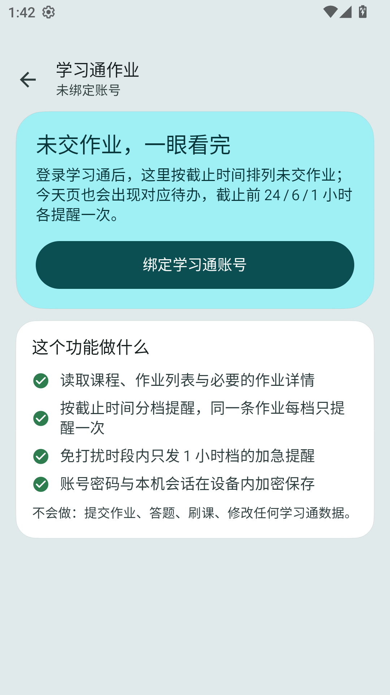
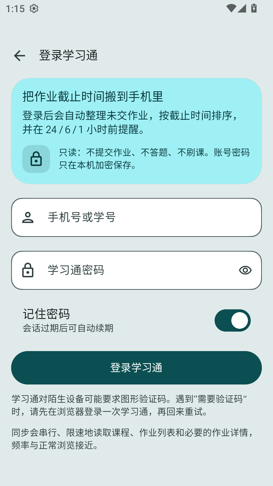
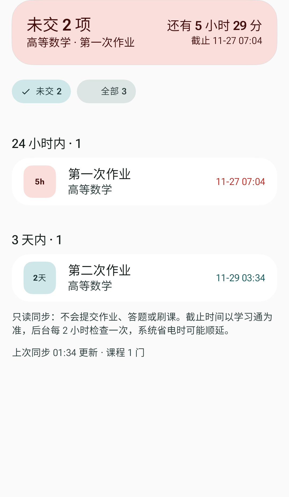
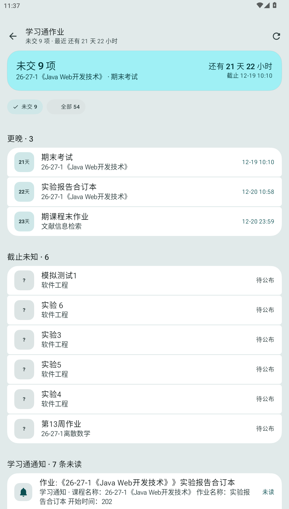
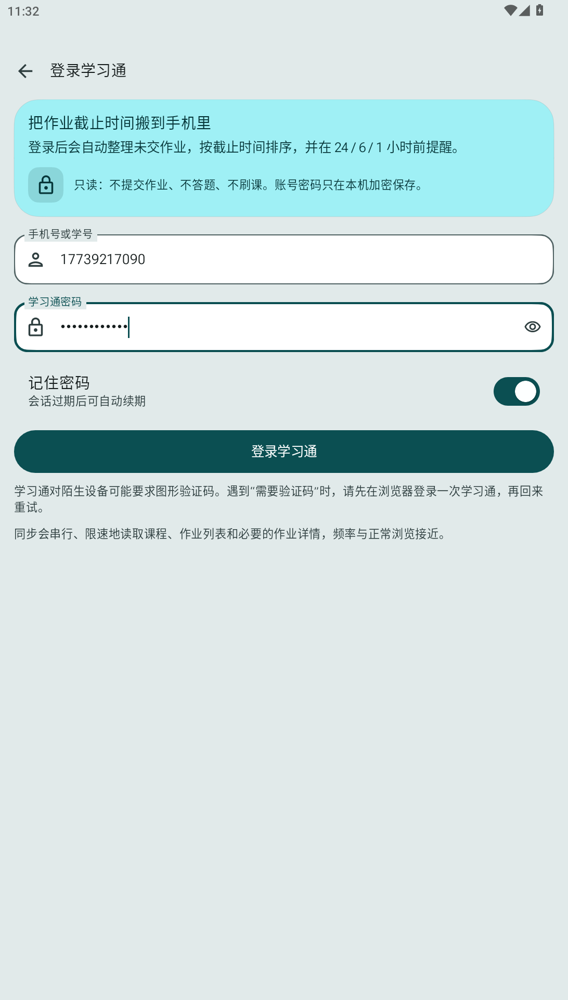
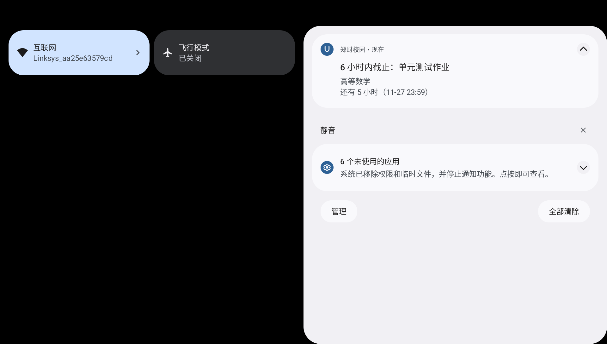
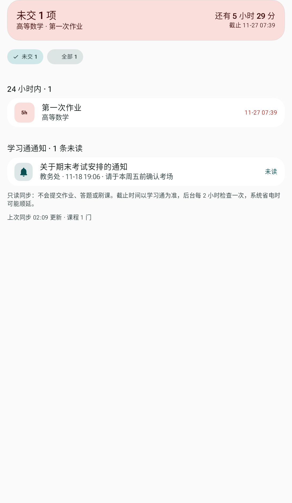
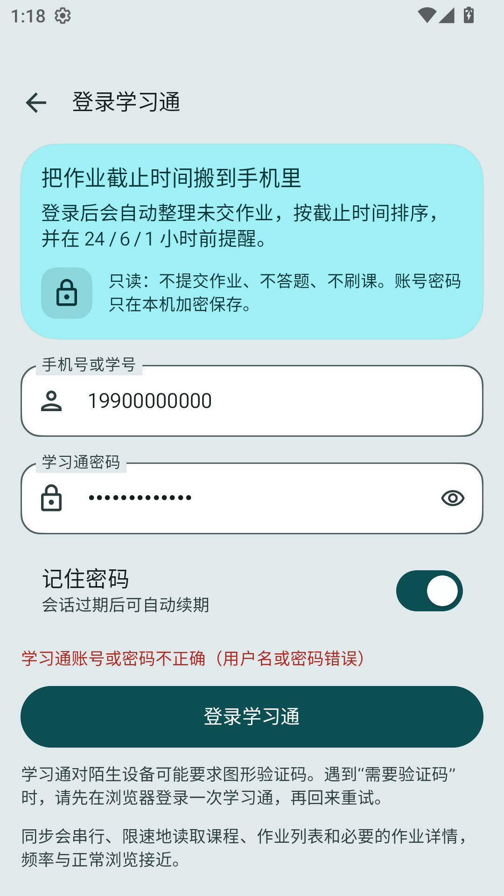

# 学习通作业提醒 · 交付证据

一句话：把 [xxt-assistant](https://github.com/led629263224-cmyk/xxt-assistant) 的学习通**登录 / 作业 / 通知**接口用 Kotlin 重新实现，接进本项目的 Prism 设计系统，做成「作业提醒」；已在 MUMU 模拟器验收，并发布 v0.2.51 → v0.2.53 三个 Release。

## 0. 一键复跑

```bash
./scripts/verify.sh
```

依次跑单元测试、校验 APK 签名与哈希、核对远端 commit 与 Release 资产，最后（有 adb 时）读设备版本与后台任务。

## 1. 需求 → 产物对照

| 需求 | 产物 |
| --- | --- |
| 探索并复用登录接口 | `core/crypto/XxtCrypto.kt`（AES-128-CBC，key=iv=`u2oh6Vu^HWe4_AES`）、`data/remote/xxt/XxtClient.kt#login` |
| 复用作业接口 | `XxtClient#fetchCourses / fetchHomeworkList / fetchHomeworkDetail`（课程页 `workEnc` 签名 + `t`/`stuenc` + 详情页作答时间） |
| 复用通知接口 | `XxtClient#fetchNotices`（`notice.chaoxing.com/pc/notice/getNoticeList`，游标 `lastGetId`/`lastPage`） |
| 作业提醒功能 | `domain/XxtHomework.kt`（分组 / 24·6·1 分档 / 免打扰 / 新作业·新通知规则）、`work/XxtHomeworkWorker.kt`（2 小时同步）、`ui/screens/homework/*`（Prism 组件） |
| 利用 skill + 设计系统 | `frontend-design` skill 参与设计取舍；界面只用 `ui/prism/*` 组件与 M3 expressive 令牌 |
| 全面验收 | 本页第 2–5 节；`docs/verification-v0.2.52.md`（命令 + 输出） |
| 构建新版本 | `app/build.gradle.kts` versionCode 58 / 0.2.53；`郑财校园-release-v0.2.53.apk` |
| 推送远端 | commit `12d0300`，GitHub master 与本地一致 |
| 发布 Release | <https://github.com/austonyan/ZCFE-Union/releases/tag/v0.2.53>（v0.2.51 / v0.2.52 保留） |

## 2. 自动化测试

- 单元测试 **131 项 / 0 失败**：登录加密 openssl 基准、时间补年份、分档与免打扰、页面解析（课程/作业/详情/通知/登录页/反爬页）、提醒去重、列表分组。
- 端到端链路 **1 项**：`XxtFlowTest` 用本机 mock 服务 + 真实 OkHttp 走完「登录→会话→课程→作业列表→详情→通知」
- 设备端用例 **5 项通过**（MUMU / Android 12）：
  - `HomeworkContentTest` × 4：概览数量、分组标题、倒计时徽标、只看未交、全部含已交、截止未知、未读通知区块
  - `XxtNotificationTest` × 1：提醒真的进入通知栏（`dumpsys notification` + 截图 `docs/img/xxt-11-notification.png`）

## 3. 真机链路

- 匿名访问 `i.chaoxing.com/base` 会被 302 到 `passport2.chaoxing.com/mlogin` —— 失效判定按此实现。
- 经宿主代理填写测试账号提交登录，服务端返回 `{"msg2":"用户名或密码错误","status":false}`，App 显示「学习通账号或密码不正确（用户名或密码错误）」（截图 `docs/img/xxt-07-login-server.png`）。
- 安装签名 Release 包后，`dumpsys jobscheduler` 可见 `+1h59m59s`（作业同步）与 `+17h46m59s`（每日电费）。

## 4. 产物校验

```
versionCode=60  versionName=0.2.55（上一版 0.2.54：sha256 06910DD1…4634C9C）
apksigner verify --verbose → APK Signature Scheme v2: true
gh release view v0.2.55 → ZCFE-Union-v0.2.55.apk，下载 HTTP 200
```


### 发布包确实包含新功能（防“陈旧产物”）

```
$ unzip -o 郑财校园-release-v0.2.54.apk 'classes*.dex'
$ grep -a 'Lcom/union/campus/...' classes*.dex
OK  Lcom/union/campus/data/remote/xxt/XxtClient;
OK  Lcom/union/campus/work/XxtHomeworkWorker;
OK  Lcom/union/campus/work/XxtNotifications;
OK  Lcom/union/campus/ui/screens/homework/HomeworkScreenKt;
OK  Lcom/union/campus/core/crypto/XxtCrypto;
$ grep -ao 'chaoxing.com...' classes*.dex
passport2.chaoxing.com/fanyalogin
mooc1.chaoxing.com/mooc2/work/list
notice.chaoxing.com/pc/notice/getNoticeList
```

## 5. 真实账号端到端（v0.2.55）

用真实账号在 MUMU（Android 12）上跑通完整链路，设备端 instrument 输出（`logcat -s XXTPROBE`）：

```
I XXTPROBE: login OK, cookies=1075
I XXTPROBE: checkLogin=true err=null
I XXTPROBE: courses=7 err=null
I XXTPROBE: [习近平新时代中国特色社会主义思想概论] items=0  progress=0/0
I XXTPROBE: [通用外语]            items=4  progress=4/4
I XXTPROBE: [文献信息检索]         items=3  progress=2/3
I XXTPROBE: [软件工程]            items=12 progress=7/12
I XXTPROBE: [26-27-1《Java Web开发技术》] items=12 progress=12/15
I XXTPROBE: [26-27-1离散数学]      items=11 progress=10/11
I XXTPROBE: [Linux系统及应用]      items=12 progress=12/12
```

设备缓存 `files/cache_data/xxt.homework.json`：54 条作业、9 项未交、7 条未读通知；
54 条中只有 3 条老师设了截止时间，另 51 条详情页里确实没有“作答时间”（待公布），
界面按“截止未知 / 待公布”展示，而不是伪造时间。

### 5.1 顺带修掉的两个真实缺陷

1. **已登录后 `/base` 会 302 到 `http://i.chaoxing.com/base?ws=1`**，明文跳转被 Android
   默认 cleartext 策略拦掉，登录态探测直接报“网络连接失败”，同步前就中断。
   已在 `network_security_config.xml` 对 `chaoxing.com` 放行明文（其余域仍禁止）。
2. 全部课程拉取失败时只弹“同步完成，8 门课程未拉到”，看不出原因。
   现在把第一门课的真实原因带进提示，并整体进入失败态而不是“还没有作业”。

## 6. 界面实拍

| 入口（Release 包） | 登录页 | 作业列表 |
| --- | --- | --- |
|  |  |  |

| 真实账号作业列表（Release 包） | 真实账号登录页 | 通知栏里的提醒 |
| --- | --- | --- |
|  |  |  |

| 未读通知区块 | 真机服务端报错 | 通知栏里的提醒 |
| --- | --- | --- |
|  |  |  |
